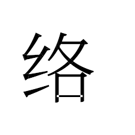
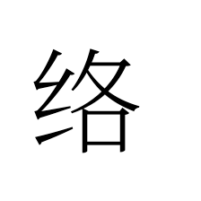
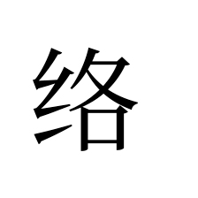

# Legacy macOS font rendering

On OS X 10.9.5, the Noto Serif SC variable subset in `fixtures/` exposes two
independent problems: requested weights render at the default weight, and
overlapping contours in U+7EDC (络) lose their intersection in native glyph
drawing and native glyph paths.

The fixes are independent startup preferences, both defaulting to `false`:

| Preference | Implementation | OS scope |
| --- | --- | --- |
| `gfx.font_rendering.legacy_macos.variations` | Pin axes with HarfBuzz subset and use a static CGFont for metrics and rasterization | Before macOS 10.13 |
| `gfx.font_rendering.legacy_macos.outlines` | Read original contours with HarfBuzz and fill with the nonzero rule | Before OS X 10.10 |

Restart after changing either preference. Variable fonts also require
`layout.css.font-variations.enabled` to be effectively `true`; platform
initialization otherwise disables and locks that preference on older systems.
The variations preference permits support to be enabled during initialization.

The implementation preserves glyph IDs and requested axes through scaled-font
serialization and WebRender cache keys. It caches at most 16 HarfBuzz faces and
8 static font instances per process. Color fonts and unsupported outline formats
use the existing native drawing fallback. Raw outlines change hinting and
antialiasing across glyphs, including LCD text rendering, so this is an opt-in
compatibility path.

## Reproduce on OS X 10.9

Run from the source root with Python 3, a C++14 compiler, `pkg-config`, and
HarfBuzz with subset support. The standalone helper does not require a browser
build. The browser tests require a Momiji build containing this patch.

```sh
legacy_font_work="$PWD/artifacts/legacy-fonts"
mkdir -p "$legacy_font_work"
python3 -m venv "$legacy_font_work/venv"
"$legacy_font_work/venv/bin/python" -m pip install \
  -r legacy-font-tests/requirements.txt

clang++ -std=c++14 -O2 -Wall -Wextra -Werror \
  -mmacosx-version-min=10.9 -dynamiclib \
  gfx/2d/LegacyMacFont.cpp \
  -o "$legacy_font_work/liblegacy-mac-font.dylib" \
  -framework ApplicationServices -framework CoreText \
  $(pkg-config --cflags --libs harfbuzz-subset)

"$legacy_font_work/venv/bin/python" legacy-font-tests/verify.py \
  --fixtures legacy-font-tests/fixtures \
  --library "$legacy_font_work/liblegacy-mac-font.dylib" \
  --out "$legacy_font_work/probe"
```

This checks five weights against FontTools, glyph IDs, advances, invalid input,
raw glyph paths, and overlap controls at fractional and transformed positions.
It also exports the static fonts used by the browser comparisons.

```sh
momiji_binary="/Applications/Momiji-Stable.app/Contents/MacOS/momiji"
"$legacy_font_work/venv/bin/python" legacy-font-tests/verify-browser.py \
  --browser "$momiji_binary" \
  --fixtures legacy-font-tests/fixtures \
  --instances "$legacy_font_work/probe" \
  --out "$legacy_font_work/browser-software" --assert-fixed --headless

"$legacy_font_work/venv/bin/python" legacy-font-tests/verify-browser.py \
  --browser "$momiji_binary" \
  --fixtures legacy-font-tests/fixtures \
  --instances "$legacy_font_work/probe" \
  --out "$legacy_font_work/browser-hardware" \
  --modes both --assert-fixed --max-aa-delta 1
```

Each output directory must be new. The harness serves fixtures on localhost,
creates isolated profiles, and checks Canvas pixels, DOM screenshots, advances,
five weights, sizes 16/24/128/512, transformed overlap, repeated rendering, and
color emoji visibility. It records the compositor and effective preferences.
The default pixel tolerance is zero; the GUI invocation explicitly permits a
maximum difference of 1/255 per channel for antialiasing rounding.

To repeat the native API investigation without the helper or browser:

```sh
"$legacy_font_work/venv/bin/python" \
  legacy-font-tests/fixtures/native_overlap_probe.py
```

Outputs go to `artifacts/legacy-fonts-native`.

## Recorded validation

The full browser was cross-compiled on Linux for x86_64 OS X 10.9, then tested
on OS X 10.9.5 (13F1911), Momiji 153.5.0, build ID `20261018150825`. This binary
used the stable tag `v153.5.0esr-mj` plus the font fix. The PR base
`153esr_test` adds two unrelated extension-signing/CI changes to that tag;
neither changes the font source used for validation.
The cross-build also used separate SDK 26.1 and Rust Linux-host compatibility
adjustments, which are outside this font patch.

The helper passed against HarfBuzz 14.4.0 and the bundled 14.2.0. Browser
results below used the bundled version. JSON and sample images are in
[`results/`](results/).

| Startup mode | Distinct weights | All five weights match static controls | Fixed-weight overlap matches trimmed control | DOM overlap / weight 400 / weight 700 |
| --- | ---: | --- | --- | --- |
| Both off | 1 | No | No | No / No / No |
| Variations only | 5 | Yes | No | No / Yes / Yes |
| Outlines only | 1 | No | Yes | Yes / No / No |
| Both on | 5 | Yes | Yes | Yes / Yes / Yes |

All software comparisons for the repaired feature were pixel-exact, including
the transformed overlap and the additional sizes. With hardware WebRender and
both fixes, all three DOM screenshots were byte-identical to controls. Canvas
differences were limited to 12 pixels at weight 550, 2 transformed-overlap
pixels, and 3 pixels at 16px/weight 400, each at most 1/255 per channel.
Repeated rendering of weight 550 was identical.

| Fixed 200 overlap, before | Fixed 200 overlap, after |
| --- | --- |
|  |  |

| Requested weight 400, before | Requested weight 400, after |
| --- | --- |
|  |  |

The user also confirmed the repair on the original website after installation.
This validation covers the supplied TrueType subset and one OS version.
General CFF2 coverage, color variable fonts, other OS versions, broad font
compatibility, and performance have not been established. Color emoji were
visible and colored; identical rendering across preference modes was not
asserted.

Font provenance and checksums are in
[`fixtures/manifest.json`](fixtures/manifest.json). The font files are under
the SIL Open Font License in [`fixtures/OFL.txt`](fixtures/OFL.txt); the static
and trimmed files are diagnostic derivatives with the original copyright
metadata retained.
